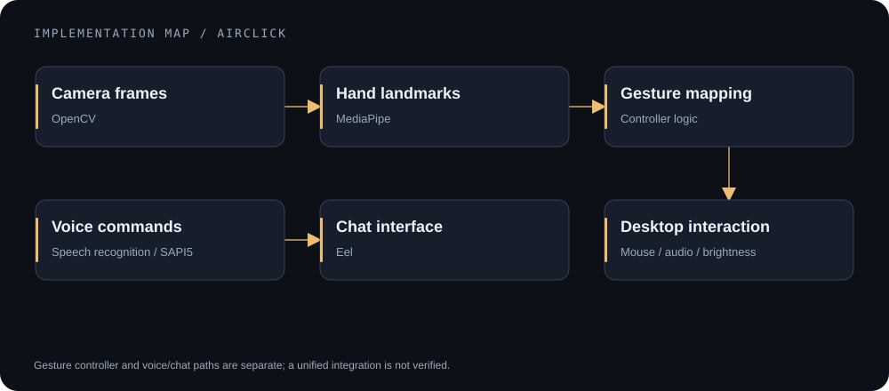
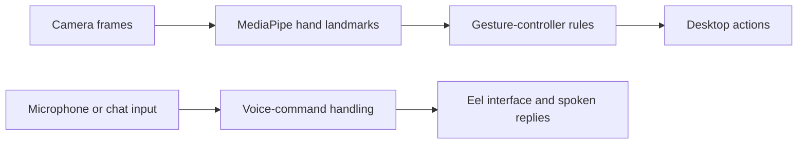

# Airclick

    

**A desktop-interaction prototype exploring hand gestures, voice commands, and a lightweight chat interface.**

[Interaction paths](#interaction-paths) · [Source map](#source-map) · [Setup boundaries](#setup-and-device-boundaries) · [License](LICENSE)

## Why this project

Camera landmarks and speech commands offer different ways to interact with a desktop. Airclick experiments with translating those inputs into mouse actions, audio/brightness controls, and conversational commands.

The repository contains gesture-controller variants and a voice/chat application. A single integrated cross-platform product has not been verified.

## Interaction paths

*The two paths show implemented areas of the source, not a verified unified runtime.*

## What the code explores

- Hand landmark interpretation and gesture-to-action mapping.
- Mouse interaction plus Windows audio and screen-brightness controls.
- Voice recognition, spoken replies, browser searches, and selected API-backed commands.
- An Eel web interface for chat input/output.

## Source map

| Path | Purpose |
|---|---|
| [src/Gesture_Controller.py](src/Gesture_Controller.py) | Main named gesture-controller implementation |
| [src/Proton.py](src/Proton.py) | Voice-command application |
| [src/app.py](src/app.py) | Eel chat interface |
| [src/check2.py](src/check2.py), [src/my.py](src/my.py) | Alternative controller experiments |
| [demo_media](demo_media/) | Existing project demonstration images |

The public-facing name is Airclick. Proton/Echo names in code and older assets reflect the implementation's development history.

## Existing demonstration material

The [voice-command image collection](demo_media/voice%20commands/) documents earlier project interactions. It is historical material, not proof that every command works in the current environment. No new screenshot, accuracy number, or latency benchmark is fabricated here.

## Setup and device boundaries

The source assumes a Windows-oriented environment: SAPI5, COM/pycaw, and some Windows paths. A camera, microphone, desktop session, and compatible audio devices may be required.

1. Review [requirements.txt](requirements.txt) and select a compatible Python/Windows environment. Several pinned dependencies are old; current-wheel availability is not established.
2. Create a virtual environment and install the requirements only in that compatible environment.
3. Choose a controller path after reviewing its device effects. The voice application is `src/Proton.py` and initializes devices/threads when started.
4. Weather/news commands need your own authorized environment configuration (`WEATHER_API_KEY`, `NEWS_API_KEY`). Do not place credentials in source files.

**Before a live demo:** restore or provide a reliable emergency stop. The named gesture controller disables PyAutoGUI's failsafe. Do not run desktop-control experiments against an unattended or important session.

## Current limitations

- No automated test suite or current hardware demonstration was established in the audit.
- Alternative controllers and an invalid editor scratch file remain in the source tree.
- Voice APIs, the fixed news-date query, article indexing, and network error handling need validation before claiming a working command set.
- Accessibility benefits, gesture accuracy, cross-platform support, and response-time improvements have not been measured.

## License and attribution

See the [GPL-3.0 license](LICENSE) and [code of conduct](CODE_OF_CONDUCT.md). Preserve applicable upstream notices when reusing this code; non-fork repository status alone does not establish original authorship.
