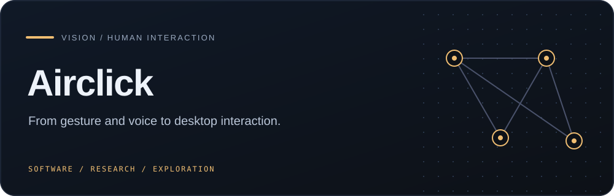
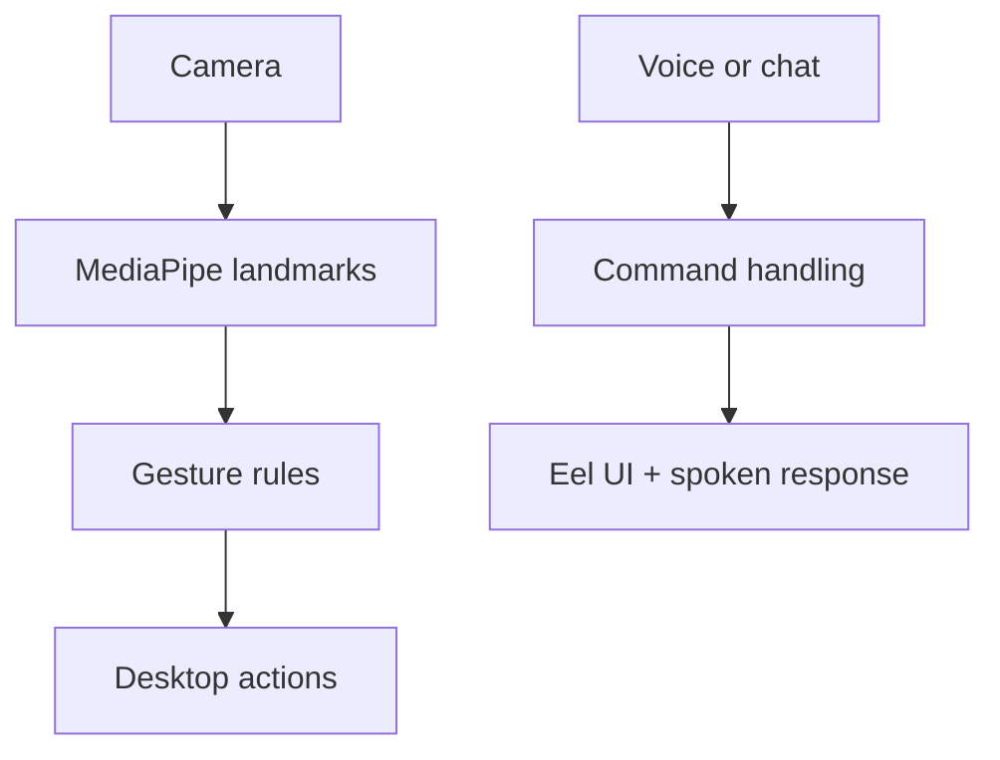

    

<strong>A desktop-interaction prototype that translates hand landmarks and voice commands into mouse, media, and assistant actions.</strong>

## Overview

A desktop-interaction prototype that translates hand landmarks and voice commands into mouse, media, and assistant actions.

### Why it matters

Airclick explores multimodal accessibility and interaction by connecting camera and microphone input to practical desktop controls.

## Key features

- MediaPipe hand-landmark tracking
- Gesture-to-mouse and system-control mapping
- Voice commands and spoken responses
- Eel-based chat interface

## Architecture

## Technology stack

**python** · **opencv** · **mediapipe** · **pyautogui** · **eel**

## Getting started

Use a compatible Windows Python environment with a camera and microphone. Install `requirements.txt`, then choose either the gesture controller or voice application. Test only in a safe desktop session with an emergency stop available.
