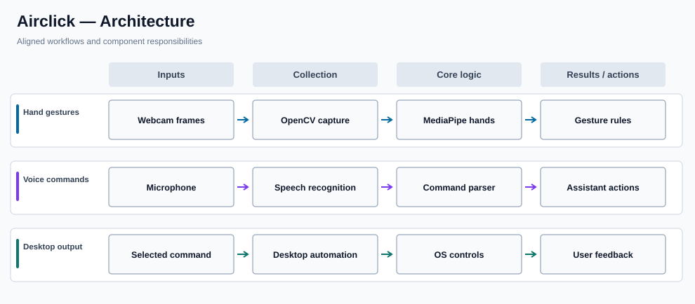

# Airclick

**Gesture and voice-controlled desktop interaction**

## Overview

Airclick is a desktop-control prototype that combines camera-based hand tracking, speech commands, and a small web-based interface. It uses MediaPipe and OpenCV to interpret visual input, desktop automation packages to trigger system actions, and speech libraries for voice interaction.

### Why it matters

Hands-free input provides an alternative way to interact with common desktop tasks. Airclick explores how computer vision and voice interfaces can be connected to real system controls in a modular Python application.

## Key capabilities

- Uses OpenCV to capture video frames for live interaction.
- Uses MediaPipe hand landmarks to recognize gesture patterns.
- Maps selected gestures to mouse and system-control actions.
- Recognizes speech commands and can provide spoken responses.
- Includes an Eel-based interface for assistant-style interactions.
- Integrates with operating-system audio and brightness controls where supported.

## System architecture



### How the workflow operates

The gesture path acquires camera frames, extracts hand landmarks, interprets those landmarks through gesture rules, and calls desktop automation functions. The voice path receives microphone input, recognizes a command, and routes it to the appropriate action or response.

The project depends on desktop-specific APIs and should be tested in a controlled environment because automated mouse, keyboard, and system controls affect the active session.

## Technology stack

| Technology | Purpose |
| --- | --- |
| **Python** | Application and control logic |
| **OpenCV / MediaPipe** | Camera input and hand landmarks |
| **PyAutoGUI / pynput** | Mouse and keyboard automation |
| **SpeechRecognition / pyttsx3** | Speech-to-text and text-to-speech |
| **Eel** | Web-based desktop interaction UI |
| **Pycaw / brightness control** | Operating-system controls |

## Repository structure

```text
src/             Gesture, assistant, and desktop-control modules
demo_media/      Available demonstration media
requirements.txt Python dependency versions
README.md        Documentation and setup
```

## Getting started

```bash
python -m venv .venv
# Activate the environment for your operating system.
pip install -r requirements.txt
# Inspect src/ for the gesture and voice entry points.
```

## Notes and prerequisites

Some audio and brightness packages are Windows-oriented. A camera and microphone are needed for the respective features, and the pinned dependencies may require a compatible Python version. Test with an emergency stop or isolated desktop session.
